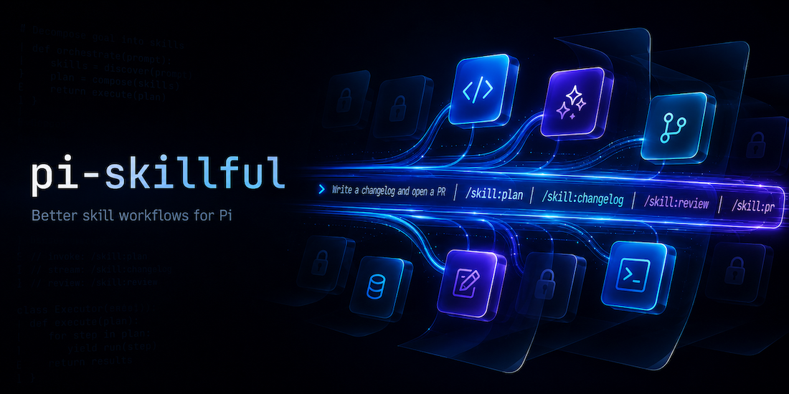

<p>
  
</p>

# pi-skillful

Make [Pi](https://pi.dev) skills easier to invoke, curate, and control without editing their source files.

`pi-skillful` provides four focused upgrades:

- **Progressive skill loading**: discover `.agents/skills/` from every ancestor directory (like `AGENTS.md`), not just within the git repo boundary.
- **Inline skill invocation**: invoke one or more skills anywhere in a prompt with `/skill:name`.
- **Skill prompt visibility**: choose which skills are hidden from the model's automatic skill-discovery prompt while keeping them explicitly invokable.
- **Session skill toggles**: assign up to nine skills to number slots and toggle model visibility while writing a prompt.

> [!WARNING]
> Pi packages can execute arbitrary code through extensions. Review package source before installing any third-party Pi package.

## Features

### Progressive skill loading

Pi discovers `.agents/skills/` directories in ancestor folders, but stops at the git repo root — skills above the repo boundary are invisible. `pi-skillful` removes that boundary by walking the full ancestor chain to the filesystem root, mirroring how `AGENTS.md` context files work.

No configuration needed. When a git repo is detected, `pi-skillful` automatically contributes `.agents/skills/` directories from parent directories above the repo root (excluding `~/.agents/skills/`, which Pi already loads globally). In projects without a git repo, Pi already walks to the filesystem root and this feature has no effect.

Skill name collisions follow Pi's first-wins rule: skills discovered closer to the working directory take precedence over skills with the same name found higher up.

### Inline skill invocation

Vanilla Pi expands `/skill:name` only when it appears at the beginning of the prompt. `pi-skillful` expands known skill markers anywhere in the prompt, including multiple skills:

```text
Use /skill:code-security and /skill:semgrep to review this change.
```

The extension replaces each known marker with that skill's `SKILL.md` content before Pi's built-in skill/template expansion runs.

### Skill prompt visibility

Hide skills from the `<available_skills>` section of the system prompt without editing each skill's `disable-model-invocation` frontmatter.

Hidden skills:

- appear in the startup `[Skills]` list in the theme's error color, while visible skills appear dimmed;
- are not advertised to the model for automatic skill selection;
- remain loaded by Pi;
- remain available for explicit invocation with `/skill:name`, including inline invocation.

Visibility covers top-level skills and verified `nzh10-skills` package resources beneath that repository’s real `skills/` root. Third-party package skills remain untouched; public package skills receive no new shortcut slots.

Configuration is stored under the `skillful` key in Pi settings (use the menu to select source-qualified IDs):

```json
{
  "skillful": {
    "visibility": { "hub:skills/pi-steward/SKILL.md": "hide" }
  }
}
```

Supported scopes:

- Global: `settings.json` in Pi's agent directory (`~/.pi/agent/settings.json` by default, or `$PI_CODING_AGENT_DIR/settings.json` when set)
- Project: `.pi/settings.json`

New choices use `skillful.visibility: { "<source-qualified-id>": "show" | "hide" | "inherit" }`, independently in each scope. Each item resolves Project > Global > steward-managed Global `skillful.visibilityDefaults` (show/hide only) > Pi. Explicit choices remain explicit even when equal to the current parent. Inherit follows the parent without copying other entries or toggle slots. Legacy `hiddenSkills` (including Project `[]`) retains its original top-level-only semantics. The previously unused `visibleSkills` remains inert. Neither list is migrated or applied to newly supported public package skills. Selecting inherit retains an explicit bypass only when a legacy list would otherwise apply.

Public IDs are `hub:<repository-relative path to SKILL.md>` beneath `skills/`. Private IDs use source paths: portable `project:`, `agent:` or `home:` references where appropriate, and local-only Global `file:` paths otherwise. Project changes to external paths without a portable reference are rejected with a notice; use Global instead. Visibility never installs unloaded resources. Neither show nor session toggles clear Pi frontmatter or another extension’s manual-only restriction.

Open the menu with:

```text
/skillful
```

The menu lists configurable skills alphabetically. Choose show, hide or inherit in the active Global/Project tab. The description shows effective Skillful visibility. Press `1` through `9` on a top-level skill to assign or clear that scope’s session toggle slot. Visibility and toggle slots are independent; changing either does not snapshot the other.

Project settings are read and the Project tab is available only when Pi trusts the current project. In an untrusted project, `pi-skillful` ignores `.pi/settings.json` and exposes only global settings.

An emptied regular Project settings file may be removed. Global settings and symlink targets remain valid JSON files even when empty.

### Session skill toggles

Assign skills to up to nine prompt-editor slots with JSON settings:

```json
{
  "skillful": {
    "hiddenSkills": ["pdf", "xlsx"],
    "toggleSlots": {
      "1": "typescript",
      "2": "code-review",
      "3": "git"
    },
    "toggleModifier": "alt"
  }
}
```

Configured slots appear on the prompt editor's top border as `N skill-name`. Project `toggleSlots`, when defined as part of a project override, replace global `toggleSlots`; otherwise global slots are used and shown in the Project tab. Long names are truncated per slot when needed so all configured slot numbers remain visible. Active slots use the theme accent color; inactive slots use the muted color. Press `alt+1` through `alt+9` by default to toggle a slot for the current session only. Only the configured modifier and assigned slot numbers are consumed while the prompt editor has focus; no modifier-number keys are reserved when no slots are configured.

`toggleModifier` defaults to `"alt"`. Supported values are `"alt"`, `"ctrl"`, `"ctrl+shift"`, `"alt+shift"`, `"ctrl+alt"`, and `"ctrl+alt+shift"`. Change it if your terminal reserves `alt+number` shortcuts. An explicitly configured project value takes precedence over the global value, including explicit `"alt"`. Unsupported explicit values fall back to `"alt"` in that scope.

On app startup, non-hidden skills are active and hidden skills are inactive. Within a running Pi process, `/new` preserves the current toggle state for the new session. Resuming, forking, cloning, reloading, or restarting Pi resets toggle state from settings. Inline `/skill:name` invocation remains explicit and works even when that skill is inactive. Skills bundled in Pi packages are never modified by these toggles.

### Prompt updates and extension composition

Toggle-border colors follow the current theme without another toggle or reload.
At very narrow widths, the complete border is clipped to the available columns.

Visibility and toggles target Pi 1.5.2's structured `systemPromptOptions.skills` API, not text replacement of the full system prompt. Pi records skill-list changes in the session transcript, alongside independent updates from other extensions such as Scout.

Only an actually pressed shortcut becomes a session override. Merely configuring a slot does not freeze persistent visibility. An active slot can lift a restriction from Skillful settings, but does not clear `disable-model-invocation` frontmatter or a restriction applied by an earlier prompt handler. Later handlers see the updated list and can apply their own policy. Third-party package skills remain outside Skillful’s controls, and public package skills receive no new toggle slots.

A deliberate full-prompt override from another extension (`systemPrompt` or `forceSystemPrompt`) takes precedence. Skillful updates the structured skill list but does not rewrite that override; its author controls any skill descriptions embedded in the replacement text. Explicit skill invocation remains available.

Structured changes let Pi update individual prompt sections. Providers that cannot accept mid-conversation system changes may still need a full prompt checkpoint; cache savings are not guaranteed.

## Installation

Install from npm:

```bash
pi install npm:pi-skillful
```

Install project-locally with Pi's `-l` flag:

```bash
pi install -l npm:pi-skillful
```

During local development from this monorepo:

```bash
pi install /path/to/pi-mono/packages/pi-skillful
```

For a one-off test run without installing:

```bash
pi -e /path/to/pi-mono/packages/pi-skillful
```

## Usage

1. Start Pi in a project with this package installed.
2. Run `/skillful`.
3. Select the Global or Project tab.
4. Choose show, hide or inherit.
5. Send a prompt normally, or explicitly invoke hidden skills with `/skill:name` anywhere in the prompt.

Example:

```text
Please analyze this using /skill:code-security, then summarize the risk.
```

## Development

This package is source-distributed. Pi loads the TypeScript extensions directly via its extension loader.

Requirements:

- Node.js >= 22.19.0
- npm for local development commands

Common commands:

```bash
npm install
npm run check
npm test
npm run pack:dry-run
```

## Contributing

Contributions are welcome. See [CONTRIBUTING.md](CONTRIBUTING.md) for development workflow and pull request guidelines.

## Security

Please report security issues privately. See the [upstream security policy](https://github.com/jvm/pi-mono/blob/main/packages/pi-skillful/SECURITY.md).

## License

MIT. See [LICENSE](LICENSE).

## Maintained local copy

This optional package is synchronized from `jvm/pi-mono`, `packages/pi-skillful`.
The repository records the upstream Git revision in `upstreams/pi-skillful.json`
and reapplies `patches/pi-skillful.patch` using `scripts/sync-pi-skillful.sh`.
Runtime sources, tests, other documentation and license are retained;
the security policy is linked upstream. No dependencies or build caches are copied.

Load only this local path or the npm package, never both. Pi supplies the host
SDK peers. Local packages do not auto-install dependencies: the existing
`@mocito/install-telemetry` dependency is optional at runtime here. A missing
telemetry package skips reporting without disabling skill features; other
loading errors are surfaced. Set `PI_TELEMETRY=0` or `PI_OFFLINE=1` to disable
reporting before dependency loading.

Global saves require an existing valid JSON-object settings file and the host
`SettingsManager` storage lock. They merge the locked current document and
atomically rename the result while that same SDK lock is held. A missing file,
unavailable lock or malformed document fails closed. Project trust and empty
project-file deletion retain upstream behavior.

For offline maintenance, pass `--source /path/to/pi-mono` to the sync script.
It exports tracked files at that checkout's HEAD, ignoring local changes.
The patch is checked before replacement; a failed replacement restores the
previous package and metadata. A hard kill or power loss can leave a
`packages/.pi-skillful-sync.*` directory and sync lock: inspect the saved `old`
tree and `old-meta` before manually recovering and removing the lock.
